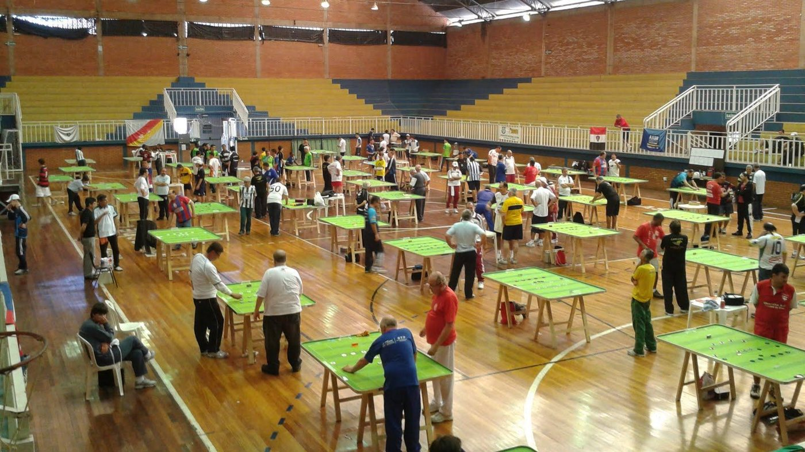

```{ojs}
dados = FileAttachment("../dados/brasileiro.json").json()

edicoes = dados.edicoes

linhas = {
  const colunas = dados.linhas;
  const nomes = Object.keys(colunas);
  return colunas.ano.map((_, i) => Object.fromEntries(nomes.map((k) => [k, colunas[k][i]])));
}

// Eixo do tempo: as edições e também os anos sem campeonato (2020 e 2021), que ficam em branco
linhaDoTempo = [...edicoes, ...dados.sem_campeonato].sort((a, b) => a.ano - b.ano)
rotulos = linhaDoTempo.map((e) => e.rotulo)
edicaoDoAno = new Map(edicoes.map((e) => [e.ano, e]))
ultimoAno = d3.max(edicoes, (e) => e.ano)
categorias = ["Adulto", "Master", "Sub-18", "Sub-15"]
ufsPrincipais = ["SP", "PR", "RJ", "PE", "SC", "RS", "GO"]
num = (x, casas = 0) => x.toLocaleString("pt-BR", {minimumFractionDigits: casas, maximumFractionDigits: casas})
pct = (x) => num(100 * x, 1) + "%"
rotuloBotonista = (b) => `${b.nome} (${b.ufo ?? "sem UF"})`

// Recortes que dependem do filtro geral
categoriasDoFiltro = ({"Todas": categorias, "Sub-15 + Sub-18": ["Sub-18", "Sub-15"]})[categoria] ?? [categoria]
linhasCat = linhas.filter((d) => categoriasDoFiltro.includes(d.cat))
variasCategorias = categoriasDoFiltro.length > 1
textoCategoria = categoria === "Todas" ? "todas as categorias"
  : categoria === "Sub-15 + Sub-18" ? "as categorias Sub-15 e Sub-18 somadas"
  : `a categoria ${categoria}`

function grafico(opcoes, {largo = false} = {}) {
  const figura = Plot.plot({
    width: largo ? Math.max(width, 780) : Math.min(width, 760),
    style: {fontSize: "11px", background: "transparent", overflow: "visible"},
    opacity: {type: "identity"},
    ...opcoes
  });
  return html`<div class="fm-rolagem ${largo ? "fm-largo" : ""}">${figura}</div>`;
}

dica = ({fill: "var(--fm-superficie)", stroke: "var(--fm-suave)", fontSize: 12, lineHeight: 1.25})

eixoEdicoes = ({type: "band", domain: rotulos, label: null, tickRotate: -55, tickSize: 3, padding: 0.18})

// Eixo só com os anos a partir do primeiro que tem o dado (evita metade do gráfico vazia)
function eixoAPartirDe(rotulosComDado) {
  const inicio = d3.min(rotulosComDado, (r) => rotulos.indexOf(r)) ?? 0;
  return {...eixoEdicoes, domain: rotulos.slice(inicio)};
}

function empilhar(registros, chaveGrupo, dominio) {
  return d3.rollups(registros, (v) => v.length, (d) => d.ano, chaveGrupo)
    .flatMap(([ano, grupos]) => {
      const edicao = edicaoDoAno.get(ano);
      const total = d3.sum(grupos, (g) => g[1]);
      return grupos.map(([grupo, n]) => ({ano, rotulo: edicao.rotulo, parcial: edicao.parcial, grupo, n, total}));
    })
    .sort((a, b) => a.ano - b.ano || dominio.indexOf(a.grupo) - dominio.indexOf(b.grupo));
}

function barrasEmpilhadas(registros, dominio, cores, rotuloY) {
  return grafico({
    height: 430, marginBottom: 150, marginLeft: 64, marginTop: 24,
    x: eixoEdicoes,
    y: {label: rotuloY, grid: true},
    color: {domain: dominio, range: cores, legend: true},
    marks: [
      Plot.barY(registros, {
        x: "rotulo", y: "n", fill: "grupo", order: null,
        fillOpacity: (d) => (d.parcial ? 0.45 : 1),
        insetTop: 1, tip: dica,
        title: (d) => `${d.rotulo}\n${d.grupo}: ${num(d.n)}\nTotal: ${num(d.total)}${d.parcial ? "\nClassificação publicada só em parte" : ""}`
      }),
      Plot.ruleY([0])
    ]
  }, {largo: true});
}

function carreiras(registros) {
  return d3.rollups(registros, (v) => {
    const anos = [...new Set(v.map((d) => d.ano))].sort(d3.ascending);
    return {id: v[0].id, nome: v[0].nome, ufo: v[0].ufo, anos, n: anos.length, sequencia: maiorSequencia(anos)};
  }, (d) => d.id).map((d) => d[1]);
}

// Maior sequência de edições seguidas. Edições com classificação parcial não interrompem a
// sequência (o botonista pode ter jogado sem aparecer na lista), mas só contam se ele aparece.
function maiorSequencia(anos) {
  const presente = new Set(anos);
  let melhor = {n: 0}, atual = null;
  for (const e of edicoes) {
    if (presente.has(e.ano)) {
      atual = atual ? {n: atual.n + 1, inicio: atual.inicio, fim: e.ano} : {n: 1, inicio: e.ano, fim: e.ano};
      if (atual.n > melhor.n) melhor = atual;
    } else if (!e.parcial) atual = null;
  }
  return melhor;
}

function top10(lista, valor) {
  const ordenada = d3.sort(lista, (d) => -valor(d), (d) => d.nome);
  const top = ordenada.slice(0, 10);
  const corte = top.length ? valor(top[top.length - 1]) : 0;
  const empatadosFora = ordenada.slice(10).filter((d) => valor(d) === corte).length;
  return {top, corte, empatadosFora};
}

function ranking(itens, {valor, rotulo, dica: textoDica, cor = "var(--fm-s1)", rotuloX}) {
  return grafico({
    height: 34 * itens.length + 50, marginLeft: width < 500 ? 150 : 200, marginRight: 40,
    x: {label: rotuloX, grid: true, tickFormat: (d) => (Number.isInteger(d) ? d : "")},
    y: {domain: itens.map(rotulo), label: null, tickSize: 0},
    marks: [
      Plot.barX(itens, {y: rotulo, x: valor, fill: cor, insetTop: 3, insetBottom: 3, tip: dica, title: textoDica}),
      Plot.text(itens, {y: rotulo, x: valor, text: (d) => num(valor(d)), dx: 6, textAnchor: "start", fontWeight: 600}),
      Plot.ruleX([0])
    ]
  });
}

notaEmpate = (r, unidade) => r.empatadosFora
  ? html`<p class="fm-nota">${r.empatadosFora === 1 ? "Outro botonista também tem" : `Outros ${r.empatadosFora} botonistas também têm`} ${r.corte} ${unidade} e ${r.empatadosFora === 1 ? "ficou" : "ficaram"} fora da lista pela ordem alfabética.</p>`
  : html``
```

Em **1989**, 93 botonistas se reuniram em São Paulo para o primeiro Campeonato Brasileiro Individual
de Futebol de Mesa na regra 12 Toques. Desde então foram **35 edições** (só não houve campeonato em 2020
e 2021, por causa da pandemia). Esta página mostra como o campeonato mudou ao longo desses anos: quantos jogam,
quantos gols saem, quem aparece mais, quem ganhou e de onde vêm os botonistas.

{fig-alt="Dezenas de mesas de futebol de mesa montadas na quadra de um ginásio, com botonistas jogando."}

Use o filtro abaixo para ver tudo por categoria — ele vale para a página inteira.

::: {.fm-filtro}
```{ojs}
viewof categoria = Inputs.radio(["Todas", "Adulto", "Master", "Sub-18", "Sub-15", "Sub-15 + Sub-18"], {label: "Categoria", value: "Todas"})
```
:::

```{ojs}
{
  const pessoas = carreiras(linhasCat);
  const maxTitulos = d3.max(titulosPorBotonista, (d) => d.n);
  const maiores = titulosPorBotonista.filter((d) => d.n === maxTitulos).map((d) => d.nome);
  const anos = new Set(linhasCat.map((d) => d.ano));
  const ufs = new Set(linhasCat.map((d) => d.uf).filter((d) => d));
  const kpi = (valor, rotulo, detalhe = "") => html`<div class="fm-kpi">
    <div class="fm-kpi-valor">${valor}</div><div class="fm-kpi-rotulo">${rotulo}</div><div class="fm-kpi-detalhe">${detalhe}</div></div>`;
  return html`<div class="fm-kpis">
    ${kpi(anos.size, "edições", `${d3.min(anos)}–${d3.max(anos)}`)}
    ${kpi(num(pessoas.length), "botonistas diferentes", "já apareceram na classificação")}
    ${kpi(ufs.size, "estados representados", "")}
    ${kpi(`${maxTitulos} títulos`, `maior campeão${variasCategorias ? " (somando categorias)" : ""}`, maiores.join(" e "))}
  </div>`;
}
```

## Participantes ano a ano

```{ojs}
participantes = linhaDoTempo.map((e) => {
  const total = linhasCat.filter((d) => d.ano === e.ano).length;
  return {rotulo: e.rotulo, parcial: !!e.parcial, total: total || NaN, informados: e.parcial && categoria === "Todas" ? e.informados : null};
})
```

```{ojs}
{
  const completos = participantes.filter((d) => !d.parcial && !isNaN(d.total));
  const parciais = participantes.filter((d) => d.parcial && !isNaN(d.total));
  const informados = participantes.filter((d) => d.informados);
  const texto = (d) => `${d.rotulo}\n${num(d.total)} botonistas na classificação${d.parcial ? "\nClassificação publicada só em parte" : ""}`;
  return grafico({
    height: 400, marginBottom: 150, marginLeft: 64, marginTop: 24,
    x: eixoEdicoes,
    y: {label: "Botonistas na classificação", grid: true, zero: true},
    marks: [
      Plot.ruleY([0]),
      Plot.line(participantes, {x: "rotulo", y: (d) => (d.parcial ? NaN : d.total), stroke: "var(--fm-s1)", strokeWidth: 2}),
      Plot.dot(completos, {x: "rotulo", y: "total", fill: "var(--fm-s1)", stroke: "var(--fm-superficie)", strokeWidth: 2, r: 4.5, tip: dica, title: texto}),
      Plot.dot(parciais, {x: "rotulo", y: "total", fill: "var(--fm-superficie)", stroke: "var(--fm-s1)", strokeWidth: 2, r: 4, tip: dica, title: texto}),
      Plot.tickY(informados, {x: "rotulo", y: "informados", stroke: "currentColor", strokeWidth: 2}),
      Plot.text(informados, {x: "rotulo", y: "informados", text: (d) => num(d.informados), dy: -8, fontWeight: 600})
    ]
  }, {largo: true});
}
```

```{ojs}
html`<p class="fm-nota">Mostrando ${textoCategoria}. Pontos vazados: anos em que o histórico publica só os primeiros colocados
(1991, 1992, 1993, 1994, 1996 e 1999); o número real de participantes foi maior, por isso eles ficam fora da linha.
${categoria === "Todas" ? "O traço com número é o total de participantes informado pela organização, quando existe." : ""}
Em 2020 e 2021 não houve campeonato.</p>`
```

::: {.fm-nota}
Seis botonistas jogaram duas categorias na mesma edição e contam uma vez em cada uma: Faoro (SP, 1997), Rogério (PR, 1998),
Robertinho (PR, 2000) e Pedro (PR, 2003), no Adulto e no Sub-18; Bruno (PR, 2005) e Vinícius (SP, 2006), no Adulto e no Sub-15.
:::

## Média de gols por partida

```{ojs}
mediaGols = linhaDoTempo.map((e) => {
  const comDados = linhasCat.filter((d) => d.ano === e.ano && d.j != null && d.gp != null);
  const jogos = d3.sum(comDados, (d) => d.j), gols = d3.sum(comDados, (d) => d.gp);
  return {rotulo: e.rotulo, gols, partidas: jogos / 2, media: jogos ? (2 * gols) / jogos : NaN};
})
```

```{ojs}
grafico({
  height: 380, marginBottom: 150, marginLeft: 64, marginTop: 24,
  x: eixoAPartirDe(mediaGols.filter((d) => !isNaN(d.media)).map((d) => d.rotulo)),
  y: {label: "Gols por partida", grid: true, nice: true},
  marks: [
    Plot.line(mediaGols, {x: "rotulo", y: "media", stroke: "var(--fm-s1)", strokeWidth: 2}),
    Plot.dot(mediaGols.filter((d) => !isNaN(d.media)), {
      x: "rotulo", y: "media", fill: "var(--fm-s1)", stroke: "var(--fm-superficie)", strokeWidth: 2, r: 4.5, tip: dica,
      title: (d) => `${d.rotulo}\n${num(d.media, 2)} gols por partida\n${num(d.gols)} gols em ${num(d.partidas)} partidas`
    })
  ]
}, {largo: true})
```

```{ojs}
html`<p class="fm-nota">Mostrando ${textoCategoria}. O gráfico começa em 2003 porque o histórico só traz jogos e gols a partir daí; 2008 e 2009 não têm estatísticas,
e em 2005 só a categoria Adulto tem. O eixo vertical não começa no zero, para dar destaque à variação.</p>`
```

## Quem mais jogou o Brasileiro

### Top 10 em número de participações

```{ojs}
rankingParticipacoes = top10(carreiras(linhasCat), (d) => d.n)
```

```{ojs}
ranking(rankingParticipacoes.top, {
  valor: (d) => d.n, rotulo: rotuloBotonista, rotuloX: "Edições disputadas",
  dica: (d) => `${rotuloBotonista(d)}\n${d.n} edições, de ${d.anos[0]} a ${d.anos[d.anos.length - 1]}`
})
```

```{ojs}
notaEmpate(rankingParticipacoes, "participações")
```

### Top 10 em participações seguidas

```{ojs}
rankingSequencias = top10(carreiras(linhasCat), (d) => d.sequencia.n)
```

```{ojs}
ranking(rankingSequencias.top, {
  valor: (d) => d.sequencia.n, rotulo: rotuloBotonista, rotuloX: "Edições seguidas", cor: "var(--fm-s3)",
  dica: (d) => `${rotuloBotonista(d)}\n${d.sequencia.n} edições seguidas, de ${d.sequencia.inicio} a ${d.sequencia.fim}${d.sequencia.fim === ultimoAno ? "\nSequência em andamento" : ""}`
})
```

```{ojs}
notaEmpate(rankingSequencias, "edições seguidas")
```

```{ojs}
html`<p class="fm-nota">Mostrando ${textoCategoria}. A sigla entre parênteses é o estado de estreia. A pausa de 2020–2021 não quebra a sequência
(não houve campeonato). Os anos com classificação incompleta também não quebram, mas só contam para quem aparece na lista — veja os critérios no fim da página.</p>`
```

## A trajetória dos campeões

```{ojs}
html`<p>Campeões da <strong>divisão principal</strong> (Série Ouro / 1ª Divisão) de ${textoCategoria}.
${variasCategorias ? "Os títulos de todas as categorias do filtro valem igual e são somados." : ""}</p>`
```

```{ojs}
campeoes = linhasCat
  .filter((d) => d.niv === 1 && d.pos === 1)
  .map((d) => ({
    ...d,
    rotulo: edicaoDoAno.get(d.ano).rotulo,
    aprov: d.j && d.pts != null ? d.pts / (3 * d.j) : NaN,
    gpj: d.j && d.gp != null ? d.gp / d.j : NaN,
    sgj: d.j && d.gp != null ? (d.gp - d.gc) / d.j : NaN
  }))

titulosPorBotonista = d3.rollups(campeoes, (v) => ({
  id: v[0].id, nome: v[0].nome, ufo: v[0].ufo, n: v.length,
  detalhe: d3.groups(v, (d) => d.cat).map(([cat, t]) => `${cat}: ${t.map((d) => d.ano).join(", ")}`)
}), (d) => d.id).map((d) => d[1])

rankingTitulos = top10(titulosPorBotonista, (d) => d.n)
```

### Quem mais venceu

```{ojs}
ranking(rankingTitulos.top, {
  valor: (d) => d.n, rotulo: rotuloBotonista, rotuloX: "Títulos", cor: "var(--fm-s4)",
  dica: (d) => `${rotuloBotonista(d)}\n${d.n} ${d.n === 1 ? "título" : "títulos"}\n${d.detalhe.join("\n")}`
})
```

```{ojs}
notaEmpate(rankingTitulos, rankingTitulos.corte === 1 ? "título" : "títulos")
```

### A campanha do campeão, ano a ano

::: {.fm-controle}
```{ojs}
viewof indicador = Inputs.radio(
  new Map([["Aproveitamento", "aprov"], ["Gols pró por jogo", "gpj"], ["Saldo de gols por jogo", "sgj"]]),
  {label: "Indicador", value: "aprov"}
)
```
:::

```{ojs}
{
  const comDados = campeoes.filter((d) => !isNaN(d[indicador]));
  const paineis = categorias.filter((c) => comDados.some((d) => d.cat === c));
  const formato = indicador === "aprov" ? pct : (x) => num(x, 2);
  const nomeIndicador = {aprov: "Aproveitamento do campeão", gpj: "Gols pró por jogo do campeão", sgj: "Saldo de gols por jogo do campeão"}[indicador];
  const campanha = (d) => [d.j != null && `${d.j}J`, d.v != null && `${d.v}V`, d.d != null && `${d.d}D`].filter(Boolean).join(" ");
  return grafico({
    height: 250 * paineis.length + 170, marginBottom: 150, marginLeft: 64, marginTop: 30, marginRight: 60,
    x: eixoAPartirDe(comDados.map((d) => d.rotulo)),
    y: {label: nomeIndicador, grid: true, nice: true, zero: true, ...(indicador === "aprov" ? {percent: true, domain: [0, 100]} : {})},
    fy: {domain: paineis, label: null, padding: 0.08},
    marks: [
      Plot.ruleX(comDados, {fy: "cat", x: "rotulo", y: indicador, stroke: "var(--fm-s4)", strokeWidth: 2}),
      Plot.dot(comDados, {
        fy: "cat", x: "rotulo", y: indicador, fill: "var(--fm-s4)", stroke: "var(--fm-superficie)", strokeWidth: 2, r: 5, tip: dica,
        title: (d) => `${d.rotulo}\n${d.cat}: ${d.nome} (${d.uf ?? "sem UF"})\n${nomeIndicador}: ${formato(d[indicador])}\n${campanha(d)}\n${d.gp} gols pró, ${d.gc} gols contra`
      }),
      Plot.ruleY([0])
    ]
  }, {largo: true});
}
```

```{ojs}
{
  const v = (x) => (x == null || Number.isNaN(x) ? "–" : x);
  const ordenados = d3.sort(campeoes, (d) => -d.ano, (d) => categorias.indexOf(d.cat));
  return html`<div class="fm-tabela"><table>
    <thead><tr>
      <th class="fm-esq">Edição</th>${variasCategorias ? html`<th class="fm-esq">Categoria</th>` : ""}<th class="fm-esq">Campeão</th><th class="fm-esq">UF</th>
      <th title="Jogos">J</th><th title="Vitórias">V</th><th title="Empates">E</th><th title="Derrotas">D</th>
      <th title="Gols pró">GP</th><th title="Gols contra">GC</th><th title="Saldo de gols">SG</th><th title="Pontos">Pts</th><th>Aprov.</th>
    </tr></thead>
    <tbody>${ordenados.map((d) => html`<tr>
      <td class="fm-esq">${d.rotulo}</td>${variasCategorias ? html`<td class="fm-esq">${d.cat}</td>` : ""}<td class="fm-esq">${d.nome}</td><td class="fm-esq">${v(d.uf)}</td>
      <td>${v(d.j)}</td><td>${v(d.v)}</td><td>${v(d.e)}</td><td>${v(d.d)}</td>
      <td>${v(d.gp)}</td><td>${v(d.gc)}</td><td>${d.gp == null ? "–" : d.gp - d.gc}</td><td>${v(d.pts)}</td>
      <td>${Number.isNaN(d.aprov) ? "–" : pct(d.aprov)}</td>
    </tr>`)}</tbody>
  </table></div>`;
}
```

::: {.fm-nota}
Aproveitamento = pontos ÷ (3 × jogos). Passe o mouse (ou toque) em um ponto do gráfico para ver quem foi o campeão e a campanha dele.
A UF é a que o campeão defendia naquele ano. Estatísticas só existem a partir de 2002 (em 2002 sem o número de jogos; empates e derrotas
a partir de 2006); 2008 e 2009 não têm estatísticas.
:::

## Os estados no Brasileiro

::: {.fm-controle}
```{ojs}
viewof criterioUF = Inputs.radio(
  new Map([["Estado que o botonista defendia no ano", "uf"], ["Estado de origem do botonista (estreia)", "ufo"]]),
  {label: "Considerar", value: "uf"}
)
```
:::

```{ojs}
html`<p class="fm-nota">${criterioUF === "uf"
  ? "Cada participação conta para o estado que o botonista representava naquela edição."
  : "Cada participação conta para o estado pelo qual o botonista estreou no Brasileiro, mesmo que depois tenha mudado. A base não tem o estado de nascimento; a estreia é a melhor aproximação disponível."}</p>`
```

### Participantes por estado, ano a ano

```{ojs}
{
  const dominio = [...ufsPrincipais, "Outros"];
  const cores = ["var(--fm-e1)", "var(--fm-e2)", "var(--fm-e3)", "var(--fm-e4)", "var(--fm-e5)", "var(--fm-e6)", "var(--fm-e7)", "var(--fm-e-outros)"];
  const registros = empilhar(linhasCat, (d) => (ufsPrincipais.includes(d[criterioUF]) ? d[criterioUF] : "Outros"), dominio);
  return barrasEmpilhadas(registros, dominio, cores, "Botonistas na classificação");
}
```

```{ojs}
{
  const outros = d3.rollups(linhasCat.filter((d) => !ufsPrincipais.includes(d[criterioUF])), (v) => v.length, (d) => d[criterioUF] ?? "sem UF")
    .sort((a, b) => b[1] - a[1]);
  return html`<p class="fm-nota">Mostrando ${textoCategoria}. “Outros” reúne ${outros.map(([uf, n]) => `${uf} (${num(n)})`).join(", ")} —
  o número entre parênteses é o total de participações em todas as edições. Barras mais claras: anos com classificação incompleta.</p>`;
}
```

### Títulos por estado, ano a ano

```{ojs}
titulos = d3.rollups(
  campeoes,
  (v) => ({n: v.length, quem: v.map((d) => `${d.cat}: ${d.nome}`)}),
  (d) => d[criterioUF] ?? "sem UF", (d) => d.ano
).flatMap(([uf, anos]) => anos.map(([ano, t]) => ({uf, ano, rotulo: edicaoDoAno.get(ano).rotulo, ...t})))

totalTitulos = d3.rollups(titulos, (v) => d3.sum(v, (d) => d.n), (d) => d.uf).sort((a, b) => b[1] - a[1])
```

```{ojs}
{
  const rampa = ["var(--fm-q1)", "var(--fm-q2)", "var(--fm-q3)", "var(--fm-q4)", "var(--fm-q5)"];
  const maximo = Math.min(d3.max(titulos, (d) => d.n) ?? 1, 5);
  // Com no máximo um título por ano (uma só categoria) não há escala: usa-se o tom do meio.
  const faixa = (d) => (maximo === 1 ? 3 : Math.min(d.n, 5));
  const celulaTexto = (filtro, tinta) => Plot.text(titulos.filter(filtro), {x: "rotulo", y: "uf", text: (d) => d.n, fill: tinta, fontWeight: 600});
  return grafico({
    height: 30 * totalTitulos.length + 180, marginBottom: 150, marginLeft: 64, marginRight: 84, marginTop: 30,
    x: {...eixoEdicoes, padding: 0.08},
    y: {domain: totalTitulos.map((d) => d[0]), label: null, tickSize: 0, padding: 0.12},
    color: {type: "ordinal", domain: maximo === 1 ? [3] : d3.range(1, maximo + 1), range: maximo === 1 ? [rampa[2]] : rampa.slice(0, maximo),
            legend: maximo > 1, tickFormat: (d) => (d === 1 ? "1 título no ano" : d === 5 ? "5 ou mais" : `${d}`)},
    marks: [
      Plot.cell(titulos, {x: "rotulo", y: "uf", fill: faixa, rx: 3, tip: dica,
        title: (d) => `${d.rotulo}\n${d.uf}: ${d.n} ${d.n === 1 ? "título" : "títulos"}\n${d.quem.join("\n")}`}),
      celulaTexto((d) => faixa(d) <= 2, "var(--fm-tinta-q-baixo)"),
      celulaTexto((d) => faixa(d) > 2, "var(--fm-tinta-q-alto)"),
      Plot.text(totalTitulos, {y: (d) => d[0], text: (d) => `${d[1]} no total`, frameAnchor: "right", dx: 82, textAnchor: "end", fontWeight: 600})
    ]
  }, {largo: true});
}
```

```{ojs}
html`<p class="fm-nota">Título = 1º lugar na divisão principal de cada categoria (aqui, ${textoCategoria}).
Passe o mouse (ou toque) em um quadrado para ver quem foram os campeões.</p>`
```

## Onde o Brasileiro já foi disputado

```{ojs}
sedes = d3.rollups(edicoes, (v) => ({cidade: `${v[0].cidade} (${v[0].uf})`, n: v.length, anos: v.map((e) => e.ano)}), (e) => `${e.cidade}|${e.uf}`)
  .map((d) => d[1])
  .sort((a, b) => b.n - a.n || a.anos[0] - b.anos[0])
```

```{ojs}
ranking(sedes.filter((d) => d.n > 1), {
  valor: (d) => d.n, rotulo: (d) => d.cidade, rotuloX: "Edições sediadas", cor: "var(--fm-s7)",
  dica: (d) => `${d.cidade}\n${d.n} edições: ${d.anos.join(", ")}`
})
```

```{ojs}
html`<p class="fm-nota">Este gráfico não muda com o filtro de categoria. Sediaram uma única edição:
${sedes.filter((d) => d.n === 1).map((d) => `${d.cidade}, em ${d.anos[0]}`).join("; ")}.</p>`
```

## Critérios adotados no relatório

**Categorias**

- As categorias que existiram em uma única edição foram reunidas com a mais próxima: o **Sub-20** (2008) entra no **Sub-18** e o
  **Infantil** (1994) entra no **Sub-15**. Em 2008 não houve Sub-18 e em 1994 ainda não havia Sub-15, então não há sobreposição.
- O filtro “Sub-15 + Sub-18” soma as duas categorias de base.

**Participantes**

- Conta-se cada linha da classificação final. Seis botonistas jogaram duas categorias na mesma edição e aparecem uma vez em cada uma:
  Faoro (SP, 1997), Rogério (PR, 1998), Robertinho (PR, 2000) e Pedro (PR, 2003), no Adulto e no Sub-18; Bruno (PR, 2005) e
  Vinícius (SP, 2006), no Adulto e no Sub-15. Nos rankings de participações, cada edição conta uma única vez por pessoa.
- Em 1991, 1992, 1993, 1994, 1996 e 1999 o histórico publica só parte da classificação. Esses anos são marcados como incompletos
  quando a classificação tem menos de 90% dos participantes informados pela organização ou menos de 60 nomes.
- Não houve campeonato em 2020 e 2021, por causa da pandemia. Esses anos aparecem no eixo dos gráficos, sem dados.

**Divisões e títulos**

- As divisões mudaram de nome (Ouro, Prata, Bronze, Extra e Copa → 1ª a 5ª Divisão). A comparação é feita pelo nível da divisão no
  ano: nível 1 é a principal (Série Ouro, 1ª Divisão ou divisão única).
- Título = 1º lugar na divisão principal da categoria. Quando o filtro reúne mais de uma categoria, os títulos de todas elas têm o
  mesmo peso e são somados.

**Gols e aproveitamento**

- Média de gols por partida = soma dos gols pró ÷ número de partidas (soma dos jogos de todos os botonistas ÷ 2).
- Aproveitamento = **pontos** ÷ (3 × jogos).
- Só entram os anos em que o histórico traz os números. Nada é calculado ou estimado quando a informação não existe; resultados por
  WO ficam como foram publicados.

**Sequências**

- Participação seguida = edições consecutivas do campeonato. 2019 e 2022 são consecutivas, porque não houve campeonato em 2020 e 2021.
- Nos anos com classificação incompleta, a ausência do nome não interrompe a sequência (o botonista pode ter jogado sem aparecer na
  lista), mas o ano só é somado se o nome aparece.

**Pessoas e estados**

- Cada botonista é identificado por um código (nome padronizado + estado de estreia), para acompanhar a mesma pessoa mesmo quando
  o nome é impresso de formas diferentes ou ela muda de estado. A identificação é automática e pode ter erros, principalmente entre homônimos.
- “Estado que defendia no ano” é a UF impressa na classificação daquela edição. “Estado de origem” é a UF da primeira participação
  do botonista no Brasileiro — o histórico não informa o estado de nascimento.
- 70 linhas não têm UF no histórico (por exemplo em 1997 e em tabelas de base de 2002) e entram em “Outros”.

Encontrou algo errado? [Avise por aqui](https://github.com/guilhermeparreira/futmesa-brasileirao/issues/new?template=inconsistencia.yml){target="_blank"}
ou deixe um comentário no fim da página — as correções são feitas na base de dados e aparecem aqui na atualização seguinte.

## Referências

- *História do Campeonato Brasileiro 12 Toques – 3ª edição*, documento em PDF com as classificações finais de 1989 a 2025, de onde
  vêm todos os dados e a foto desta página. Está disponível na página de
  [documentos históricos da CBFM](https://www.cbfm.com.br/documentos-historicos/){target="_blank"} (Confederação Brasileira de Futebol de Mesa).
- [Planilha Excel com a base completa](https://github.com/guilhermeparreira/futmesa-brasileirao/raw/main/saida/campeonato_brasileiro_12_toques.xlsx):
  classificação de todas as edições, campeonatos, verificações de qualidade e dicionário das colunas.
- [Base de dados estruturada e código de extração](https://github.com/guilhermeparreira/futmesa-brasileirao){target="_blank"}:
  as regras de leitura do PDF, as correções manuais e as verificações de qualidade.
- [Padronização dos nomes dos botonistas](https://github.com/guilhermeparreira/futmesa-brasileirao/blob/main/dados/depara_botonistas.csv){target="_blank"}
  e [dos clubes](https://github.com/guilhermeparreira/futmesa-brasileirao/blob/main/dados/depara_clubes.csv){target="_blank"} (de-para).

```{ojs}
html`<p class="fm-nota">Dados atualizados em ${new Date(dados.gerado_em + "T12:00:00").toLocaleDateString("pt-BR")}.</p>`
```
