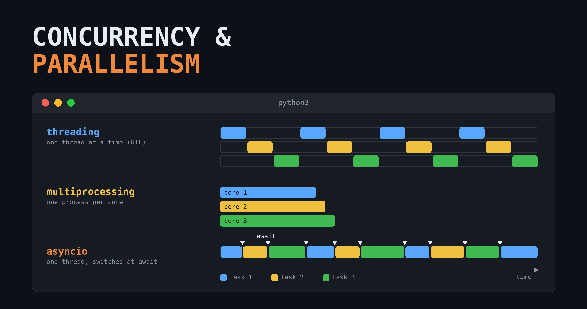
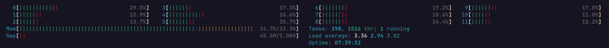

{fig-align="center"}

Once upon a time, computers had a single core that could run only one stream of instructions at a time, so programs were executed strictly sequentially.

Nowadays, computers have multiple physical cores, and each physical core can expose more than one *logical* core (hardware thread) through Simultaneous Multithreading (SMT), which Intel calls Hyper-Threading. On Intel and AMD consumer processors, this is usually 2 hardware threads per core, while some server processors (such as IBM POWER) go up to 8. You can check how many logical cores your machine has with `os.cpu_count()` in Python.

Therefore, it is worth taking advantage of all this power and running more than one thing at a time.

> "Parallel programming can be defined as a model aims to create compatible programs with ready environments to execute code simultaneously." Jan Palach - Parallel Programming with Python

Before going further, it is important to separate two terms that are often used interchangeably:

-   **Concurrency**: multiple tasks make progress during the same period of time, but not necessarily at the same instant. The tasks take turns.
-   **Parallelism**: multiple tasks are executed at the exact same instant, on different cores.

Parallelism is a special case of concurrency: every parallel program is concurrent, but not every concurrent program is parallel. That is why the Python documentation groups all the tools below under the name [Concurrent Execution](https://docs.python.org/3/library/concurrency.html).

In Python, we have three main ways of running code concurrently:

-   Multithreading (`threading`)
-   Multiprocessing (`multiprocessing`)
-   Asynchronous I/O (`asyncio`)

And a high-level interface on top of the first two: `concurrent.futures`.

In order to choose one of these methods, we first need to understand the problem we are trying to solve, and pick the right tool for it. The main question is: is my code waiting for something (**I/O-bound**), or is it busy computing (**CPU-bound**)?

## Multithreading

A multithreaded program is a program that uses multiple threads to run its tasks. A thread is the unit that actually executes your code, and every process has at least one thread (the main thread). All the threads of a process share the same memory space, and in Python they are real OS threads, which means the operating system decides when each one runs.

The downside of multithreading in Python is the GIL (Global Interpreter Lock): a lock that allows only a single thread to execute Python bytecode at a time inside a process. So, even if you start 8 threads on an 8-core machine, only one of them is running Python code at any given moment, while the others wait for the GIL to be released.

Since Python 3.13 there is an optional *free-threaded* build (PEP 703) in which the GIL can be disabled, and since Python 3.14 this build is officially supported (PEP 779). In this build, threads can truly run in parallel. The trade-offs are that some third-party libraries may not support it yet, and that a program using a single thread runs slower on the free-threaded build than on the regular one (about 40% slower in 3.13, reduced to roughly 5-10% in 3.14), because the interpreter needs extra internal work to stay safe without the GIL.

Be aware that the GIL does **not** protect you from race conditions. It protects the interpreter's internal state, not your program's logic: an operation such as `counter += 1` is made of several bytecode instructions, and a thread can be switched in the middle of them. Whenever threads modify shared data, you should protect it with a `threading.Lock`. Without the GIL, these bugs simply become more likely to show up.

Therefore, in the usual scenario, threads run concurrently, not in parallel: only one executes Python code, while the others wait.

The advantage of multithreading shows up when the program performs Input/Output (I/O) operations, such as waiting for a server to respond, reading a file, or querying a database. While a thread is blocked waiting for I/O, it releases the GIL, and another thread can run. The threads then operate in an interleaved way. For example:

1.  Thread 1 sends a request to the server and waits for the response (it releases the GIL, and the OS schedules another thread).
2.  Thread 2 sends its request to the server and also waits for the response.
3.  Thread 1 receives the data from the server and finishes.
4.  Thread 2 receives the data from the server and finishes.

Instead of waiting for two responses one after the other, the program waits for both at the same time.

Even though the threads are not running at the same instant, this is the impression the user gets, because the switches between threads happen very fast. Even when no thread is waiting for I/O, Python asks the running thread to release the GIL every 5 milliseconds by default (see `sys.getswitchinterval()`), so that every thread gets its turn.

Many C extensions, such as NumPy, also release the GIL during heavy computations, so threads can be useful in these cases too.

## Multiprocessing

When we use multiprocessing, the main program (the parent process, whose ID you get with `os.getpid()`) starts several child processes (from inside a child, `os.getppid()` returns the parent's ID). Each child process has its own Python interpreter, its own memory, and **its own GIL**. Therefore, the processes do not compete for a single lock, and they can run truly in parallel, at the same time, on different cores.

This is useful when you have a CPU-bound operation (heavy calculations, data processing, model training) and want to use all the cores of your machine. You can start more processes than you have cores, but the benefit is achieved when each process gets its own core; beyond that, the processes just take turns.

The price to pay is that processes do not share memory. The data needs to be serialized (pickled) and sent to each process, and the results need to be sent back to the parent. Starting a process is also much more expensive than starting a thread. So, for light operations, or for I/O-bound tasks, multiprocessing can be slower than multithreading and will use more memory.

A good experiment is to watch how many processes are running on your OS.

### Threads and processes in the OS

For example, take a look at this `htop` screenshot:

We have 198 tasks, which in this case means processes, and they are using 1526 threads in total, but only 1 is running at this moment (the others are sleeping, waiting for something to happen).

So, an OS can start as many processes as it needs (regardless of the number of cores), and each process can have multiple threads associated with it. Your machine is, all the time, running a multiprocess *and* multithreaded workload.

## Futures

The `concurrent.futures` module provides a single, high-level interface for both approaches above: `ThreadPoolExecutor` (a pool of threads) and `ProcessPoolExecutor` (a pool of processes). You submit a task to a pool of *workers*, and you immediately receive a **Future**: an object that represents a result that is not ready yet. Later, you call `.result()` to get the value, waiting for it if needed.

The nice part is that switching from threads to processes is usually a matter of changing a single line, since both executors have the same API (`submit`, `map`, and so on). It does not add a new way of running code, it just makes threads and processes easier to use.

## Asyncio

Asyncio - **A**synchronous **I**/**O** (**I**nput/**O**utput) - is a Python library for writing concurrent code using the `async` and `await` syntax. As the name says, it is also aimed at I/O operations, but differently from multithreading, it runs on a **single thread**. Since there is only one thread, the GIL is not a concern here. Instead of the OS deciding when to switch, **we** mark in the code the points where the program is waiting (with `await`), and at those points it can jump to another task.

It is like going to a coffee shop and ordering a machine coffee. The clerk presses the button to make the coffee, and instead of waiting for it to be ready, they take the order of the next customer. After that, they go back to the machine and collect the first coffee, which is ready by now.

Each of these routines is, in Python, a **coroutine**: a function defined with `async def`, that can pause its execution and resume later from the same point. The **single** clerk orders the coffee, `await`s for it to be ready, checks whether there is another customer, charges them, and then returns to the machine to collect the coffee for the first customer.

The one coordinating all of this is the **event loop**, managed by `asyncio` (usually started with `asyncio.run()`). It keeps track of all the tasks and, whenever a task hits an `await`, it resumes another task that is ready to continue.

The main advantage over multithreading is that the switching is cooperative: we tell the event loop exactly where the code can be paused, instead of letting the OS interrupt the threads at any point. This avoids many race conditions, and since tasks are much lighter than threads, a single program can handle thousands of simultaneous connections.

The disadvantage is that the whole code needs to be asynchronous: a single blocking call (such as `time.sleep()` or `requests.get()`) freezes the whole event loop, since there is only one thread. Therefore, the libraries you use also need to support asynchronous code (for example, `aiohttp` or `httpx` instead of `requests`), and many of them do not. When there is no alternative, you can send the blocking call to a thread with `asyncio.to_thread()`.

## Conclusion

| | Multithreading | Multiprocessing | Asyncio |
|-----------------|-----------------|-----------------|-----------------|
| Python module | `threading`, `concurrent.futures.ThreadPoolExecutor` | `multiprocessing`, `concurrent.futures.ProcessPoolExecutor` | `asyncio` |
| Concurrent or parallel? | Concurrent (parallel only in the free-threaded build) | Parallel | Concurrent |
| Unit of work | OS thread | OS process | Coroutine (task) |
| Who decides when to switch? | The OS (preemptive) | The OS (each process runs on its own) | The code, at each `await` (cooperative) |
| Affected by the GIL? | Yes, one thread runs Python at a time | No, each process has its own GIL | Not relevant, it is a single thread |
| Memory | Shared between threads | Separate for each process; data must be pickled | Shared, single thread |
| Startup cost | Low | High | Very low |
| Race conditions | Yes, needs locks | Rare, since nothing is shared by default | Fewer, switches only at `await` |
| Best for | I/O-bound tasks, or C extensions that release the GIL | CPU-bound tasks | I/O-bound tasks with many connections |
| Main drawback | GIL limits CPU-bound code | Memory and communication overhead | Every library must be async |

: Summary of the three approaches {#tbl-summary}

As a rule of thumb: if your code is waiting, use threads or asyncio; if your code is computing, use processes.

## Glossary

I have included some terminology that may or may not be directly related to the text, but that may help with a general understanding:

-   **Concurrency**: two tasks make progress in the same period of time, but not necessarily at the same instant.
-   **Parallelism**: two tasks are executed at the same instant.
-   **Race condition**: when more than one thread accesses the same piece of memory at the same time, and at least one of them modifies it, so the result depends on the order in which the threads happen to run.
-   **Synchronous code**: runs a task until it is finished, and only then starts the next one.
-   **Asynchronous code**: can start a task, pause it, and later resume from where it stopped, until it is finished.
-   **Future**: an object representing a result that will be available in the future. The computation may start now or later.
-   **Lazy evaluation**: an expression is only evaluated when its value is needed.
-   **Future vs. lazy evaluation**: a lazy value does nothing until it is requested. A Future, on the other hand, is usually computed in parallel or concurrently with the rest of the code, at some moment between its creation and the moment the code needs (or waits for) the result. So, it can run in a thread or in a process.
-   **Promise**: a commitment that a computation will be performed and its result delivered. The term is common in JavaScript; in Python, the closest concept is the Future.
-   **`with`**: guarantees that the cleanup code of a context manager (closing a file, releasing a lock, shutting down an executor) is executed when the block ends, even if an exception is raised inside it.
-   **Generator**: a Python function returns a generator when it uses `yield` instead of `return`. Its values are produced lazily, one at a time.
-   **`yield from` and `await`**: ways of consuming another generator or coroutine, respectively. `await` can only be used inside an asynchronous function (`async def`). `yield from` was used by the old generator-based coroutines, which were removed in Python 3.11.
-   **`aiohttp.ClientSession`**: manages HTTP requests asynchronously, without blocking the event loop.
-   **`requests`**: a blocking library; it runs requests synchronously.
-   **`async`**: defines that a function is asynchronous (a coroutine).
-   **`await`**: pauses the current coroutine until the awaited operation finishes, letting the event loop run other tasks in the meantime.
-   **Task**: a unit of work that the computer must execute.
-   **Worker**: "the guy" that executes the tasks. It can be a thread or a process, for example. What a worker is depends on the context of your code.
-   **I/O-bound**: a task whose time is mostly spent waiting for input/output (network, disk, database).
-   **CPU-bound**: a task whose time is mostly spent computing.

## Thanks

Special thanks for the great youtube channel by @EduardoMendes and its [playlist](https://www.youtube.com/playlist?list=PLOQgLBuj2-3KU6TnzJQJVfL5aiaOQuZ4o) on parallelism and concurrency.

Happy coding!
