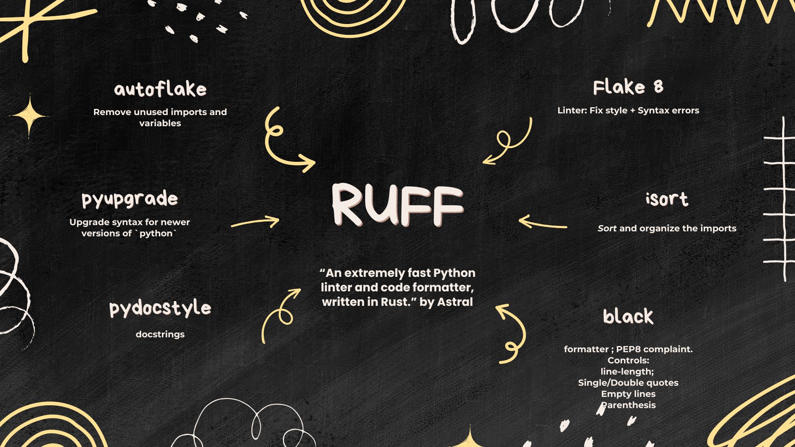

:::{.cell}
{fig-align="center"}
:::


Hello guys!

Today I want to talk about [RUFF](https://github.com/astral-sh/ruff), my default formatter (and much more) for Python language.

In a nutshell, RUFF can be seen as a tool that performs all these tasks:

RUFF = `Flake8` + `isort` + `black` + `pydocstyle` + `pyupgrade` + `autoflake`

`Flake8` = `Linter`, which reports style + syntax errors

`isort` = *Sort* the imports

`black` = `formatter` ; mostly `PEP8` compliant, but with a default line-length of 88 instead of PEP 8's 79. It handles single/double quotes, empty lines and parentheses

`pydocstyle` = docstrings

`pyupgrade` = upgrade syntax for newer `python` versions

`autoflake` = Remove unused imports and unused variables

So, instead of having to set up each one individually, use `RUFF` and have all these tools into a single one. `RUFF` was written in `rust`, so it is not a wrap of the previously mentioned. Also, it is way faster than the previous tools.

## Setting it up on VsCode

To give suggestions on the fly, I use the [`Ruff VsCode Extension`](https://marketplace.visualstudio.com/items?itemName=charliermarsh.ruff).

Besides that, I have my `settings.json` with my personal preferences:

```json
// Use Ruff as the default formatter for Python files
"[python]": {
"editor.defaultFormatter": "charliermarsh.ruff",
"editor.codeActionsOnSave": {
    "source.fixAll": "explicit",
    "source.organizeImports": "explicit"
}
},
// Formatter for notebook cells
"[jupyter]": {
"editor.defaultFormatter": "charliermarsh.ruff"
},
// Enable format on save for notebooks
"notebook.formatOnSave.enabled": true,
"editor.formatOnSave": true,
```

But these are only global settings in my personal environment.

Working with others on the same project can be painful if you don't have a default formatter (because other team members can have different formatters and specifications); as a result, code may change the formatting for a new user. Therefore, having a `.vscode/settings.json` inside of the folder of your project guarantees that everyone will use the same formatter. For that, just copy your personal settings to `.vscode/settings.json`.

I also make `Ruff` as a default extension in `.vscode/extensions.json`:

```json
{
    "recommendations": [
        "charliermarsh.ruff"
    ]
}
```

Last but not least, you can also install `ruff` in your environment and implement it on your CI/CD routines. But it will not be covered here. Installing the extension and using the `.vscode/settings.json` guarantees that the suggestions will be made on the fly. But it depends on your IDE and that everyone from your team uses it.

## Bonus (Caveat)

I struggled to start using a tool like this because I used to write code in a single long line. I always received the `E501: line-too-long` warning from `pycodestyle/Flake8`. It happens when a line is longer than 79 characters, which is the recommendation in PEP 8 (`ruff`, like `black`, uses a slightly larger default of 88 characters). After applying a tool like `ruff` my code changed drastically (as it would force me to break lines), and it was uncomfortable in the beginning. So, I started to relax the parameter of the `line-length` a little bit (from the default to, for example, 150 characters) and started to analyze the impact of change. Then I realized that the impact on my previous code was not large at all.

Leaving the limit as the default, PEP 8 argues that you can open multiple files side by side, making also easier to see the `git diff` changes.

Anyway, if you think that this limit is small, you can relax it a little bit globally, doing it by:

```toml
[tool.ruff]
line-length = 130 # E501 (line-too-long) now only warns above 130 characters

lint.ignore = [
    "E701", # Ignore single-line if statements
]
lint.extend-select = ["D"] # Enable the docstring rules (pydocstyle), which are off by default
extend-include = ["*.ipynb"]

[tool.ruff.format]
quote-style = "double"
docstring-code-format = true

[tool.ruff.lint.pydocstyle] # Docstring style that the "D" rules check against
convention = "google"
```

Or, if you only want to keep a few specific lines as they are:

- Add `# noqa: E501` at the end of a line, so the linter stops warning that it is too long.
- Add `# fmt: skip` at the end of a line, so the formatter does not reformat it.
- Wrap a block of code between `# fmt: off` and `# fmt: on`, so the formatter leaves the whole block untouched.

Happy coding.
